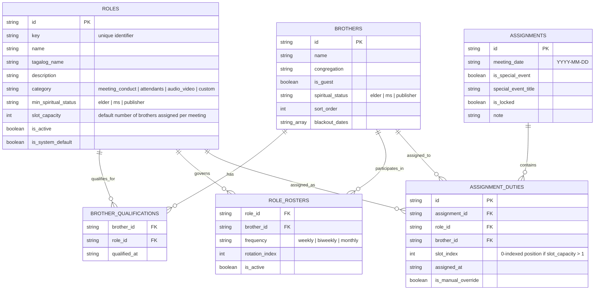

# Congregation Scheduler - Role Management System Design

**Date**: 2026-08-07  
**Status**: Proposed / Under Review  
**Topic**: Normalized Role Management Architecture, SQL Visuals, Data Model, and Master Skill Specification

---

## 1. Executive Summary & Premise

The current Congregation Scheduler system stores role information across fragmented TypeScript structures:
1. **Hardcoded Role Unions** (`DutyRole` string literal type).
2. **Double Qualification Logic**: A brother has a static `qualifications?: DutyRole[]` array on `Speaker`, while `AppSettings.roleRules` stores a `rosterIds: string[]` array.
3. **Hardcoded Assignment Columns**: `Assignment` interface hardcodes `chairmanId`, `conductorId`, `readerId`, `speakerId`, `entranceAttendantId`, `auditoriumAttendantId`, and `micServerIds`. Adding any new role requires modifying UI components, types, schemas, and service functions.
4. **Authority Roles Bypass**: Static fixed assignments for Conductor and Auditorium Attendant duplicate duty settings in `AppSettings.authorityRoles`.

### The Solution: Normalized Data Architecture & Dynamic Role System
This system design introduces:
- A fully normalized relational entity model (`Brothers`, `Roles`, `Brother_Qualifications`, `Role_Rosters`, `Assignments`, `Assignment_Duties`).
- A **Two-Tier Eligibility Engine**: Separation between *Qualification* (capability based on spiritual status and explicit qualifications) and *Active Roster* (inclusion in automatic rotation).
- A **Dynamic Role Schema**: Custom role extensibility (defining slot capacity, required spiritual status `Elder`/`MS`/`Publisher`, category) without hardcoding new columns into the database or TypeScript entities.
- A **Master Role Management Skill** published to `.agents/skills/role-management/SKILL.md`.

---

## 2. SQL Visuals & Relational Architecture (ERD)

### 2.1 Entity Relationship Diagram (ERD)



---

## 3. Normalized SQL Schemas

Below is the SQL DDL representation for relational backends or IndexedDB schema alignment:

```sql
-- 1. Brothers Table
CREATE TABLE brothers (
    id VARCHAR(64) PRIMARY KEY,
    name VARCHAR(255) NOT NULL,
    congregation VARCHAR(255) NOT NULL DEFAULT 'Green Heights',
    is_guest BOOLEAN NOT NULL DEFAULT FALSE,
    spiritual_status VARCHAR(32) NOT NULL DEFAULT 'publisher', -- 'elder', 'ms', 'publisher'
    sort_order INT NOT NULL DEFAULT 0,
    blackout_dates JSONB DEFAULT '[]'::jsonb, -- Array of ISO date strings YYYY-MM-DD
    created_at TIMESTAMP WITH TIME ZONE DEFAULT CURRENT_TIMESTAMP
);

-- 2. Roles Table (Supports Dynamic Custom Roles)
CREATE TABLE roles (
    id VARCHAR(64) PRIMARY KEY,
    key VARCHAR(64) UNIQUE NOT NULL, -- e.g. 'chairman', 'conductor', 'reader', 'mic'
    name VARCHAR(255) NOT NULL,
    tagalog_name VARCHAR(255),
    description TEXT,
    category VARCHAR(64) NOT NULL DEFAULT 'meeting_conduct', -- 'meeting_conduct', 'attendants', 'audio_video', 'custom'
    min_spiritual_status VARCHAR(32) NOT NULL DEFAULT 'publisher', -- 'elder', 'ms', 'publisher'
    slot_capacity INT NOT NULL DEFAULT 1, -- e.g. mic = 2, chairman = 1
    is_active BOOLEAN NOT NULL DEFAULT TRUE,
    is_system_default BOOLEAN NOT NULL DEFAULT FALSE,
    created_at TIMESTAMP WITH TIME ZONE DEFAULT CURRENT_TIMESTAMP
);

-- 3. Brother Qualifications (Junction Table)
CREATE TABLE brother_qualifications (
    brother_id VARCHAR(64) REFERENCES brothers(id) ON DELETE CASCADE,
    role_id VARCHAR(64) REFERENCES roles(id) ON DELETE CASCADE,
    qualified_at TIMESTAMP WITH TIME ZONE DEFAULT CURRENT_TIMESTAMP,
    PRIMARY KEY (brother_id, role_id)
);

-- 4. Role Rosters (Active Rotation Rosters)
CREATE TABLE role_rosters (
    role_id VARCHAR(64) REFERENCES roles(id) ON DELETE CASCADE,
    brother_id VARCHAR(64) REFERENCES brothers(id) ON DELETE CASCADE,
    frequency VARCHAR(32) NOT NULL DEFAULT 'weekly', -- 'weekly', 'biweekly', 'monthly'
    rotation_index INT NOT NULL DEFAULT 0,
    is_active BOOLEAN NOT NULL DEFAULT TRUE,
    PRIMARY KEY (role_id, brother_id)
);

-- 5. Meeting Assignments Header
CREATE TABLE assignments (
    id VARCHAR(64) PRIMARY KEY,
    meeting_date DATE UNIQUE NOT NULL,
    is_special_event BOOLEAN NOT NULL DEFAULT FALSE,
    special_event_title VARCHAR(255),
    is_locked BOOLEAN NOT NULL DEFAULT FALSE,
    note TEXT,
    created_at TIMESTAMP WITH TIME ZONE DEFAULT CURRENT_TIMESTAMP
);

-- 6. Assignment Duties (Normalized Duty Line Items)
CREATE TABLE assignment_duties (
    id VARCHAR(64) PRIMARY KEY,
    assignment_id VARCHAR(64) REFERENCES assignments(id) ON DELETE CASCADE,
    role_id VARCHAR(64) REFERENCES roles(id) ON DELETE RESTRICT,
    brother_id VARCHAR(64) REFERENCES brothers(id) ON DELETE SET NULL,
    slot_index INT NOT NULL DEFAULT 0, -- Slot number (0, 1 for multi-slot roles)
    is_manual_override BOOLEAN NOT NULL DEFAULT FALSE,
    assigned_at TIMESTAMP WITH TIME ZONE DEFAULT CURRENT_TIMESTAMP,
    CONSTRAINT unique_duty_slot UNIQUE (assignment_id, role_id, slot_index)
);
```

---

## 4. Business Logic & Two-Tier Eligibility Matrix

### 4.1 Two-Tier Candidate Eligibility Algorithm

For any targeted assignment (`Meeting Date`, `Role`):
1. **Tier 1: Qualification Check**
   - Candidate MUST be marked as qualified for the role in `brother_qualifications`.
   - Candidate's `spiritual_status` MUST satisfy `Role.min_spiritual_status` (e.g. `chairman`, `conductor`, `reader` require `spiritual_status` in `['elder', 'ms']`).
2. **Tier 2: Active Roster & Availability Check**
   - Candidate MUST be in the `role_rosters` for that role (`is_active = TRUE`).
   - Candidate MUST NOT have the target date in `blackout_dates`.
   - Candidate MUST NOT already be assigned to another duty on the same `assignment_id` (Collision Avoidance).
   - Candidate duty count for the current month MUST NOT exceed `maxMonthlyDutiesPerBrother`.

---

## 5. Master Skill Specification (`.agents/skills/role-management/SKILL.md`)

The new skill will live in `.agents/skills/role-management/SKILL.md` and provide clear workflows for:
- Auditing & normalizing role data.
- Managing qualifications vs active rosters.
- Adding dynamic roles.
- Performing collision-free auto-assignments.

---

## 6. Verification Plan

### Automated Tests / Type Checking
- Run `npx tsc --noEmit` to verify type safety across TypeScript definitions and components.
- Run `npm run dev` to ensure no runtime errors occur during render and state transitions.

### Manual Verification
- Test adding/toggling brother qualifications in Role Rules UI.
- Test active roster filtering and search in `RoleRulesView`.
- Verify auto-fill scheduling resolves conflicts cleanly without dual-assigning a brother on the same date.
